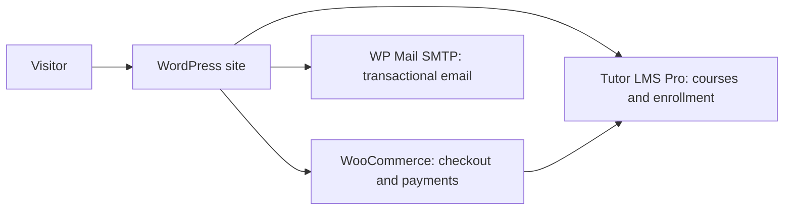

# WordPress LMS and Commerce Platform

**Online course platform with memberships and payments**

    

> [!NOTE]
> **Source code is private by design.** This project was delivered for a client under confidentiality. Publishing the source, schemas or detailed integration logic would make the system easy to reverse-engineer, and in a fast-moving market that would put the client's business at risk. This repository is a case study only: what was built, how it is structured at a high level, and what I contributed.

## Overview

An online course platform on WordPress that combines Tutor LMS Pro for course delivery with WooCommerce for payments. The work covered enrollment and checkout flows, guest checkout, a plugin audit, database cleanup, speed and SEO optimization, and reliable transactional email.

## What was built

- Course delivery with Tutor LMS Pro
- WooCommerce payments with fixed enrollment flow
- Guest checkout
- Plugin audit and database cleanup
- Speed and SEO optimization
- Transactional email through WP Mail SMTP

## Architecture (high level)

A simplified map of the main building blocks. Internal services, data models and integration details are intentionally left out.

## Tech stack

| Layer | Technologies |
|---|---|
| CMS | WordPress |
| Learning management | Tutor LMS Pro |
| Commerce | WooCommerce |
| Email | WP Mail SMTP |

## Engineering highlights

- Enrollment tied reliably to WooCommerce orders
- Plugin audit and database cleanup for a faster, more stable site
- Email deliverability handled with proper SMTP instead of default mail

## My role

Audit, fixes, performance work and ongoing maintenance.

## Links

- Live site: https://openingpaths.com

## What is in this repository

- This README with the project overview and architecture map
- No client source code, credentials, data or internal documentation

---

Built by **[Muhammad Kamran](https://github.com/raiskami)** at **[SvnStack](https://svnstack.com)**

[Website](https://svnstack.com) · [LinkedIn](https://www.linkedin.com/in/muhammad-kamran-391a50345) · [Upwork](https://www.upwork.com/freelancers/muhammadkamran128)

